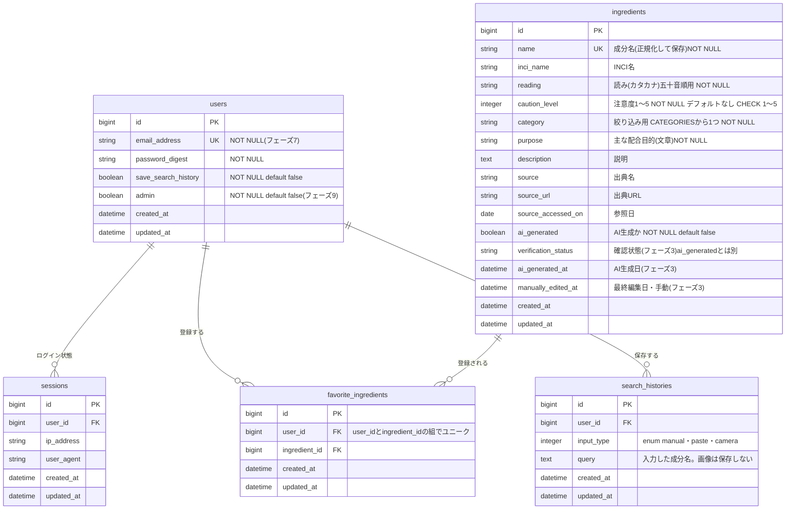

# ER図 — うらラベル(ura-label)

テーブル・カラム・関連の設計図。テーブルの作成・変更(マイグレーション・モデル)を計画・レビューするときに参照する。

> - 「【案】」は未確定。フェーズ1の着手前に決めたら、このファイルを更新する
> - 実際の DB の状態は `db/schema.rb` が正。この図と食い違ったら、どちらに合わせるかを相談する

---

## ER図

## テーブルを作るフェーズ

| テーブル                                    | フェーズ                                                                        |
| ------------------------------------------- | ------------------------------------------------------------------------------- |
| `ingredients`                               | 1(`verification_status` / `ai_generated_at` / `manually_edited_at` は 3 で追加) |
| `users` / `sessions`                        | 7(`admin` は 9 で追加)                                                          |
| `favorite_ingredients` / `search_histories` | 7                                                                               |

## 設計の意図

1. **ingredients は1テーブルにまとめる**: 出典・カテゴリのテーブル分割は今はやらない。項目ごとに出典を検証したくなった段階で `IngredientSource` などを提案する
2. **`ai_generated` と `verification_status` は別のカラム**: 「AI生成か」と「確認済みか」は別の属性
3. **表示する日付は専用のカラムで持つ**: `ai_generated_at` / `manually_edited_at`。`updated_at` は自動の処理でも変わるため表示に使わない。手動で編集しても `ai_generated` と `ai_generated_at` は変えない
4. **search_histories と ingredients は直接つながない**: `query` に入力した文字列をそのまま保存する。未登録・取得失敗の成分も履歴に残せる
5. **退会時はまとめて削除**: `users` に `dependent: :destroy` を付け、気になる成分・検索履歴・セッションを削除する
6. **ログインしていない利用者のデータは保存しない**: `search_histories.user_id` は NOT NULL
7. **未登録・取得失敗の成分は保存しない**: 画面に表示するだけにし、注意度3で登録されないようにする

## フェーズ1で決めたこと(issue #18)

- **`reading` / `source_accessed_on`**: フェーズ1で追加する。`reading` はカタカナ・NOT NULL(成分辞典を五十音順に並べるため)、`source_accessed_on` は任意
- **`caution_level`**: デフォルトなし。NOT NULL と DB のチェック制約(1〜5)を付ける。未登録・取得失敗は保存しないため、デフォルトは要らない
- **`category`**: 固定リスト(`Ingredient::CATEGORIES`)から主なものを1つ・必須。複数の目的がある成分は、ほかの目的を `purpose` に書く
- **`purpose`**: NOT NULL(結果画面で必ず表示するため)
- **aliases**: 今は持たない。表記ゆれは名前の正規化とあいまい検索で吸収する。必要になったら `ingredient_aliases` テーブルを提案する(別名もあいまい検索するなら、別テーブルのほうがインデックスを張りやすい)

## 未確定の点

- **`verification_status` の値**: フェーズ3(AI 生成の追加時)に、`ai_generated_at` / `manually_edited_at` と一緒に追加する。未確認・確認済みの2つか、ほかの状態も持つかはそのときに決める
